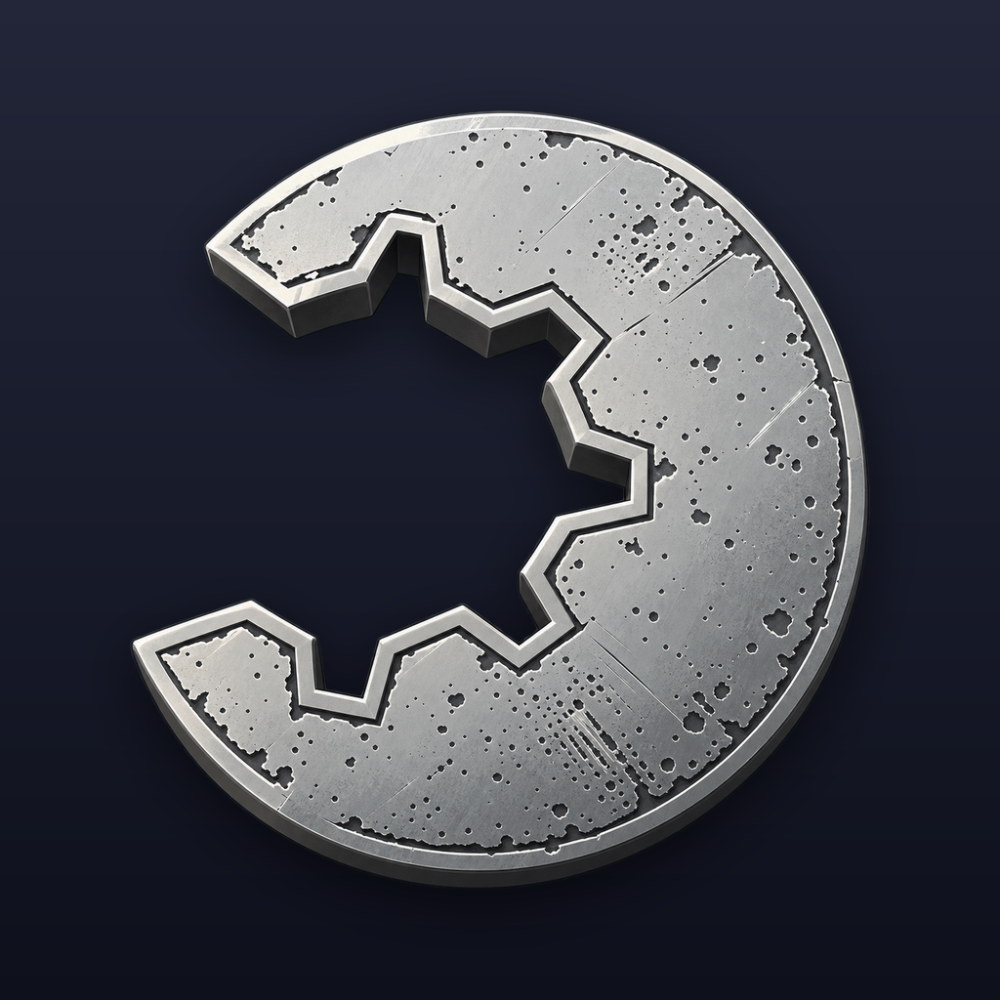
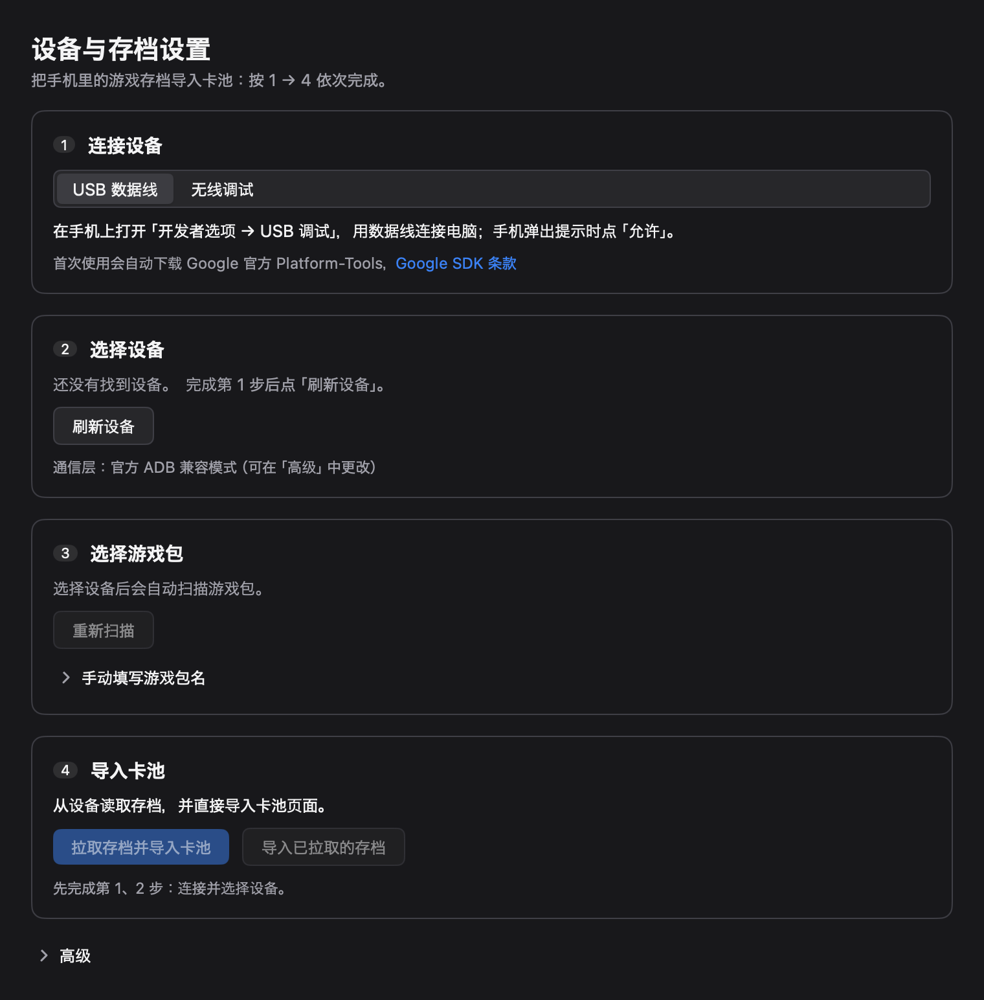

<p align="center"></p>
<h1 align="center">bdon-mygo</h1>

<p align="center"><b>BanG Dream! Our Notes 组卡加速器 · bdon.moe 组卡工具桌面版</b><br>
原生多线程计算 · ADB 一键导入存档到卡池 · 支持含 LUCK 的激走曲组卡<br>
<sub>デッキ編成を高速化 ／ セーブデータをカードプールへ取り込み ／ Faster deck building for Our Notes</sub></p>

<p align="center">简体中文 · <a href="#日本語">日本語</a> · <a href="#english">English</a></p>

> bdon-mygo 是独立的粉丝自制工具，与 Bushiroad、Craft Egg、游戏的其他权利人以及 StarMoe / Moenotes **均无关联**，也未获得其认可或支持。游戏名称仅用于说明兼容对象。

## 它做什么

在 bdon.moe 上组卡嫌慢、卡池要一张张录？bdon-mygo 把 **bdon 组卡页** 装进桌面窗口，计算交给 **原生多线程引擎**，用满全部 CPU 核心。连上手机还能 **一键把游戏存档导入卡池**，不用手动录卡。界面、数据和计算规则都和 bdon 网页版一致。

bdon-mygo 是一个轻量的原生外壳（Go + WKWebView，基于 [MyGo](https://github.com/egoist/mygo)），在系统 WebView 中直接打开 Moenotes 站点的组卡工具 <https://bdon.moe/tools/deck>（适用于《BanG Dream! Our Notes》）。网页界面和数据都来自该站点本身，本应用不复制、不打包、不镜像其代码或数据，只增加两项功能：

1. **原生多线程计算引擎**：网页的组卡计算原本在浏览器 Worker 中运行。预加载脚本把 `/deck/deck-worker.js` 的计算协议转交给 Go → Rust FFI 原生引擎（[ournotes-deck](https://github.com/li-yifei/ournotes-deck)），引擎使用多个 CPU 核心，大卡池下搜索明显更快。网页下载的计算数据经过 SHA-256 校验后在本机计算，输入和结果与网页版保持一致；如果网页协议更新导致不兼容，应用会提示更新，不会给出错误结果。
2. **ADB 存档导入**：通过 USB 或无线调试（扫码或配对码）连接 Android 设备，读取本机游戏存档中的 `_player`，写入网页本机 IndexedDB 中的「卡池」。导入后无需逐张录入卡牌即可直接计算。注入脚本会拦截网页把账号存档或卡池写入云端的请求。



## 系统要求

- macOS 12 或更高版本，Apple Silicon（arm64）；libusb 已内置（从源码构建需要 `brew install libusb`）
- Windows 10/11（x64 或 ARM64）：需要 Microsoft Edge WebView2 Runtime，Windows 10/11 已预装；若应用无法打开，请从 [微软官网](https://developer.microsoft.com/microsoft-edge/webview2/) 安装 Evergreen Runtime
- Linux：尚未发布，可从源码构建（需要 GTK 3 和 WebKitGTK 4.1，即 `libwebkit2gtk-4.1.so.0`：Debian/Ubuntu `sudo apt install libwebkit2gtk-4.1-0`，Fedora `sudo dnf install webkit2gtk4.1`，Arch `sudo pacman -S webkit2gtk-4.1`）
- Windows 版不含「Go 独立 USB」通信层（需要 cgo 与 libusb），USB 连接使用官方 ADB 兼容模式；无线调试与「Go 独立 TCP」在所有平台可用
- 导入存档需要一台已开启 **USB 调试** 或 **无线调试** 的 Android 设备
- 网络连接（用于加载 bdon.moe）

## 安装（发行版）

从 [Releases](../../releases) 下载对应平台的文件（`SHA256SUMS` 可用于校验）：

| 平台 | 文件 | 安装 |
|---|---|---|
| macOS（Apple Silicon） | `bdon-mygo-<版本>-darwin-arm64.dmg` | 打开 DMG，把 `bdon-mygo.app` 拖到「应用程序」。经过 Developer ID 签名和公证的版本可直接双击；ad-hoc 签名版本（Release 说明中会注明）请右键点击应用并选择「打开」，或运行 `xattr -dr com.apple.quarantine /Applications/bdon-mygo.app` |
| Windows | — | 即将发布（免安装 zip），目前可从源码构建 |
| Linux | — | 尚未发布，可从源码构建 |

## 使用

1. 打开应用，等待 bdon.moe 组卡工具加载完成。
2. **计算**：在网页中照常设置活动、歌曲和条件，然后点击计算。计算自动交给原生引擎执行。
3. **导入存档**（可选）：打开菜单「bdon-mygo → 设置…」（⌘,）或窗口标题栏的设置按钮，按窗口中的 1 → 4 步操作：
   1. 连接设备：USB 数据线（开启「USB 调试」）或无线调试（扫码或配对码）。设备弹出授权提示时点「允许」。
   2. 选择设备。
   3. 选择游戏包（自动扫描）。
   4. 「拉取存档并导入卡池」（⌘↩）；也可以「导入已拉取的存档」，不连接设备直接导入上次拉取到本机的存档。
4. 「高级」中可以切换搜索算法（默认 / 实验性替换算法，立即生效）和 ADB 通信层（官方 ADB 兼容模式、Go 独立 USB、Go 独立 TCP）。默认的兼容模式和无线配对使用 Google 官方 Platform-Tools（不随应用分发）。首次需要时，设置窗口会先请你确认 [Android SDK 条款](https://developer.android.com/studio/terms)，同意后才从 `dl.google.com` 下载到应用缓存目录。Go 独立 USB 使用打包的 libusb，复用 `~/.android/adbkey`。
5. 设置窗口右上角的语言选单可选择原生界面语言：跟随系统（默认，按系统「首选语言」列表中第一个受支持的语言，括号中显示检测结果）、简体中文、繁體中文、日本語或 English，立即应用到设置窗口和菜单，并保存在 `preferences.json`；卡池页面内的桌面端提示立即切换，标题栏按钮在页面重新加载后更新。测试时可用环境变量 `OURNOTES_LANG` 强制指定语言。

## 数据存放位置

| 类型 | macOS | Windows | Linux（源码构建） |
|---|---|---|---|
| 设置：`preferences.json`、ADB 通信层与算法选择 | `~/Library/Application Support/bdon-mygo/` | `%APPDATA%\bdon-mygo\` | `$XDG_CONFIG_HOME/bdon-mygo/`（默认 `~/.config/bdon-mygo/`） |
| 数据：已拉取的存档与账号数据、导入的实验引擎 | `~/Library/Application Support/bdon-mygo/` | `%LOCALAPPDATA%\bdon-mygo\Data\` | `$XDG_DATA_HOME/bdon-mygo/`（默认 `~/.local/share/bdon-mygo/`） |
| 缓存（可重建）：校验过的计算数据、下载的 Platform-Tools、临时目录 | `~/Library/Caches/bdon-mygo/` | `%LOCALAPPDATA%\bdon-mygo\Cache\` | `$XDG_CACHE_HOME/bdon-mygo/`（默认 `~/.cache/bdon-mygo/`） |
| 日志：`bdon-mygo.log` | `~/Library/Logs/bdon-mygo/` | `%LOCALAPPDATA%\bdon-mygo\Logs\` | `$XDG_STATE_HOME/bdon-mygo/`（默认 `~/.local/state/bdon-mygo/`） |

- 便携模式（Windows/Linux）：可执行文件旁存在 `data` 文件夹（或名为 `portable` 的文件）时，四类内容分别保存在 `data/config`、`data/data`、`data/cache`、`data/logs`。
- 开发运行（`bun run dev`）：全部位于源码目录下的 `.local-storage/`（数据在根目录，另有 `config/`、`cache/`、`logs/`）；首次运行会复制已安装版本的偏好设置。
- 设置窗口「高级 → 数据位置」列出这四个目录，并可在访达/资源管理器中打开。
- macOS 从旧布局升级时，首次启动会把 `datasets`、`tools` 等可重建内容移动到 `~/Library/Caches/bdon-mygo/`，设置和数据保持原位，不会删除任何用户数据。

应用不会向 app bundle 写入任何数据，发行包不含个人数据，签名在运行后保持有效。从旧版本（`Our Notes Deck.app`，数据位于 `Contents/Resources/storage/`）升级时，若新数据目录为空，首次启动会自动复制旧数据；旧数据保持原样，确认无误后可自行删除旧 app。

## 从源码构建

依赖：Xcode Command Line Tools、Go（版本见 `go.mod`）、[Bun](https://bun.sh)、`pkg-config`、libusb。MyGo CLI 由 `package.json` 固定的 npm 包 `mygo-cli` 提供。

```sh
brew install go pkg-config libusb
git clone https://github.com/li-yifei/bdon-mygo.git
cd bdon-mygo
bun install
bash scripts/fetch-native-engine.sh   # 获取 libournotes_ffi.dylib
bun run build:macos                   # build/darwin-arm64/bdon-mygo.app 与 dist/ 中的 DMG（默认 ad-hoc 签名）
bun run dev                           # 开发模式
```

发行构建：`bun run build`（即 `bash scripts/build-release.sh [平台…]`）在 macOS 上原生构建 `darwin/arm64`（CGO + 打包 libusb），并用一次 `mygo build -platform windows/amd64,windows/arm64` 交叉编译 Windows（`CGO_ENABLED=0`，任何机器均可），把 DMG、Windows 免安装 zip 和 `SHA256SUMS` 放到 `dist/`（不制作安装程序）。Linux 暂不发布，但代码可在 Linux 上构建与测试（`go build ./...`，运行时需要 WebKitGTK 4.1）。每个平台只打包一个原生引擎（`resources/<os>-<arch>/libournotes_ffi.<dylib|so|dll>`，由脚本临时放置、构建后删除），来源为 `OURNOTES_ENGINE_DIR`（默认同级 `../engine-artifacts`，否则 `.native-engines/`），缺少的平台由 `scripts/fetch-native-engine.sh release` 从 `docs/native-engine-release.txt` 指定的 ournotes-deck Release 下载并按 `SHA256SUMS` 校验。推送 `v<版本>` 标签后，`.github/workflows/release.yml` 构建 macOS 并上传到草稿 Release（Windows 发布暂未启用）。

`scripts/fetch-native-engine.sh build` 使用 `OURNOTES_DECK_SOURCE`、同级目录 `../ournotes-deck` 或自动克隆的 [ournotes-deck](https://github.com/li-yifei/ournotes-deck)，在 `docs/native-search-revision.txt` 固定的版本上构建 `ournotes-ffi`（需要 Rust 工具链）；`download` 模式从 GitHub Release 下载，版本通过 `OURNOTES_DECK_RELEASE_TAG` 指定，可用 `OURNOTES_DECK_SHA256` 校验。不带参数时能构建则构建，否则下载。运行时按 `OURNOTES_FFI_LIB`、应用资源目录（macOS 为 `Contents/Resources`，其他平台为可执行文件目录）、可执行文件目录、当前目录的顺序查找 `libournotes_ffi.dylib` / `.so` / `.dll`。

产品名称、Bundle ID 和目录名统一定义在 `product.json`。`bun run dev` 启动开发版：Go 原生 UI 和 `shell/inject.js` 修改后由 MyGo 自动编译、重启，Rust 动态库更新后也会自动重载；开发脚本启用 CGO，保留 Go 独立 USB 通信。`bun run dev:pairing` 启动全新无线配对测试：每次使用独立的 ADB server 端口、密钥和缓存，退出时清理，不影响系统 ADB server 与原有密钥。

验证：`go build ./...`、`go vet ./...`、`go test ./...`、`node_modules/.bin/mygo vet .`、`node --test shell/inject.test.mjs`。真实 FFI 测试可设置 `OURNOTES_NATIVE_TEST_DATA` 为 deck-data 文件路径。搜索引擎接入说明见 [搜索引擎 ABI](docs/search-engine-abi.md)。

### 环境变量

为兼容旧版本，环境变量沿用 `OURNOTES_` 前缀。

| 变量 | 作用 |
|---|---|
| `OURNOTES_FFI_LIB` | 指定原生引擎动态库 |
| `OURNOTES_ADB` | 指定 `adb` 可执行文件，跳过自动下载 |
| `OURNOTES_SIGN_IDENTITY` | macOS 签名身份（默认 ad-hoc `-`） |
| `OURNOTES_ENGINE_DIR`、`OURNOTES_ENGINE_FETCH`、`OURNOTES_ENGINE_RELEASE_TAG` | 发行构建的引擎来源、是否下载缺少的引擎、引擎 Release |
| `OURNOTES_DEV_STORAGE` | 开发运行的存储目录（默认 `.local-storage/`） |
| `OURNOTES_DECK_*`、`OURNOTES_FFI_OUT` | `scripts/fetch-native-engine.sh` 的来源、版本、校验与输出路径 |
| `OURNOTES_DEV_MODE`、`OURNOTES_PAIRING_TEST_*` | 开发脚本内部使用 |
| `OURNOTES_NATIVE_TEST_DATA`、`OURNOTES_TEST_*`、`OURNOTES_SAVE_TEST_ROOT` | 可选的集成测试 |

## 隐私

- **离开本机的数据**：只有加载 bdon.moe 网页产生的正常流量（`bdon.moe`、`assets.bdon.moe`、`storage.bdon.moe`），以及该网页自身加载的第三方资源。按照 [bdon.moe 隐私说明](https://bdon.moe/privacy)，这些资源包括 Google Analytics 和 Google Fonts。这些请求与用普通浏览器访问该网站相同，受 bdon.moe 的隐私政策约束。
- **Platform-Tools**：首次需要 `adb` 时访问 `dl.google.com` 下载。
- **本地网络**：无线调试配对时在本地网络进行 mDNS 发现（`_adb-tls-*`），不访问互联网。
- **存档与账号 ID**：在本机解析，只写入 WebView 中 bdon.moe 页面的本地存储（IndexedDB / localStorage），**本应用不会上传到任何地方**。如果你在网页中登录 StarMoe 账号并使用其同步或公开主页功能，相关数据处理由 bdon.moe 负责。
- 本应用没有遥测、统计、崩溃上报或自动更新请求。

## 致谢

- [Moenotes / bdon.moe](https://bdon.moe)（StarMoe 团队，[StarMoe-org/moenotes](https://github.com/StarMoe-org/moenotes)，前端 AGPL-3.0）：组卡工具的界面与数据均属于该项目，本应用只是它的非官方客户端。计算器本身的问题请先在本仓库反馈，不要打扰原站。
- [ournotes-deck](https://github.com/empty-sekai/ournotes-deck)（MIT / Apache-2.0）及本应用使用的 [原生桌面分支](https://github.com/li-yifei/ournotes-deck)
- [MyGo](https://github.com/egoist/mygo)、[go-adb](https://github.com/pgaskin/go-adb)、[gousb](https://github.com/google/gousb)、[libusb](https://libusb.info) 等，完整列表见 [THIRD_PARTY_NOTICES.md](THIRD_PARTY_NOTICES.md) 和 [ACKNOWLEDGEMENTS.md](ACKNOWLEDGEMENTS.md)

## 联系

问题与建议请通过本仓库的 [Issues](../../issues) 反馈。请勿在 issue 或 PR 中发布密钥、存档、账号 ID 或游戏文件，此类内容会被删除。StarMoe / Moenotes 团队或任何权利人如对本项目有疑虑，请开 issue 或通过 GitHub 联系 [@li-yifei](https://github.com/li-yifei)，我会尽快回应，并按要求调整或下架。

## 许可与声明

本项目代码以 [MIT](LICENSE) 许可发布。《BanG Dream! Our Notes》及其素材、名称和商标归 Bushiroad 及相关权利人所有。本项目不分发任何游戏素材或游戏数据，按现状提供，使用风险由用户自行承担。

---

<a id="日本語"></a>

## 日本語

**bdon-mygo** は『BanG Dream! Our Notes』（アツドリ）のデッキ編成ツール bdon.moe をデスクトップで使うための非公式アプリです。

- **編成計算が速い**：bdon の編成ページの計算を、PC の全 CPU コアを使うネイティブエンジンで実行します。結果は Web 版と同じ計算規則です。
- **セーブデータを取り込み**：Android 端末を USB またはワイヤレスデバッグで接続し、ゲームのセーブデータを bdon のカードプールへそのまま登録。カードを一枚ずつ入力する必要はありません。root は不要です。
- **LUCK を含む激走楽曲**にも対応（ネイティブエンジン使用時）。
- 現在の配布は macOS（Apple シリコン）版のみ。Windows 版は準備中です。セーブデータはローカルにのみ保存され、アップロードされません。

[Releases](../../releases) から DMG をダウンロードし、`bdon-mygo.app` を「アプリケーション」にドラッグしてください。初回は右クリック →「開く」で起動します（ad-hoc 署名のため）。設定ウィンドウの右上で表示言語を選べます。

Bushiroad、Craft Egg、StarMoe / Moenotes とは関係のないファン制作ツールです。

---

<a id="english"></a>

## English

> bdon-mygo is an independent fan-made tool. It is **not affiliated with, endorsed or supported by** Bushiroad, Craft Egg, any rights holder of the game, or StarMoe / Moenotes. The game name is used only to describe compatibility.

### What it does

bdon-mygo is an unofficial, lightweight native shell (Go + WKWebView, built on [MyGo](https://github.com/egoist/mygo)) that opens the Moenotes deck tool at <https://bdon.moe/tools/deck> for *BanG Dream! Our Notes* in the system WebView. The web UI and data come from that site as-is; the app does not copy, bundle or mirror its code or data. It adds two things:

1. **Native multithreaded engine.** A preload script routes the page's `/deck/deck-worker.js` calculation protocol through Go to a native Rust engine ([ournotes-deck](https://github.com/li-yifei/ournotes-deck)) over FFI. The engine uses several CPU cores, so searches over large card pools are much faster. Calculation data downloaded by the page is SHA-256 verified and computed locally; inputs and results match the web version. If the page's protocol changes, the app asks you to update instead of returning wrong results.
2. **ADB save import.** Connect an Android device over USB or wireless debugging (QR code or pairing code). The app reads `_player` from your local game save and fills the card pool in the page's local IndexedDB, so you no longer enter cards by hand. The preload script blocks the page's cloud writes of the account save or card pool.

### Requirements

- macOS 12+, Apple Silicon (arm64); libusb is bundled (source builds need `brew install libusb`)
- Windows 10/11 (x64 or ARM64): needs the Microsoft Edge WebView2 Runtime, which Windows 10 and 11 include; if the app does not open, install the Evergreen runtime from [Microsoft](https://developer.microsoft.com/microsoft-edge/webview2/)
- Linux: not yet released; builds from source (needs GTK 3 and WebKitGTK 4.1, `libwebkit2gtk-4.1.so.0`: Debian/Ubuntu `sudo apt install libwebkit2gtk-4.1-0`, Fedora `sudo dnf install webkit2gtk4.1`, Arch `sudo pacman -S webkit2gtk-4.1`)
- The Windows app has no "Go direct USB" transport (it needs cgo and libusb): USB uses the official ADB compatible mode. Wireless debugging and "Go direct TCP" work everywhere
- For save import: an Android device with **USB debugging** or **Wireless debugging** enabled
- Internet connection (to load bdon.moe)

### Install from a release

Download the file for your platform from [Releases](../../releases) (`SHA256SUMS` lists their checksums):

| Platform | File | Install |
|---|---|---|
| macOS (Apple silicon) | `bdon-mygo-<version>-darwin-arm64.dmg` | Open it and drag `bdon-mygo.app` to Applications. Notarized releases open normally; for ad-hoc signed releases (stated in the release notes), right-click the app and choose **Open** once, or run `xattr -dr com.apple.quarantine /Applications/bdon-mygo.app` |
| Windows | — | Coming soon (portable zip); builds from source today |
| Linux | — | Not yet released; builds from source |

### Usage

1. Launch the app and wait for the bdon.moe deck tool to load.
2. **Calculate**: use the page as usual. Calculations go to the native engine automatically.
3. **Import a save** (optional): open **bdon-mygo → Settings…** (⌘,) or the settings button in the title bar, then follow steps 1 → 4: connect the device (USB debugging, or wireless debugging by QR or pairing code; accept the prompt on the device), pick the device, pick the game package (scanned automatically), and choose **Pull save and import into card pool** (⌘↩). **Import pulled save** imports the last pulled save without a device.
4. The Advanced section switches the search engine (default or experimental, applied immediately) and the ADB transport (official ADB compatible mode, Go direct USB, Go direct TCP). Compatible mode and wireless pairing use Google's Platform-Tools, which the app does not redistribute. The first time they are needed, the settings window asks you to accept the [Android SDK terms](https://developer.android.com/studio/terms), and only then downloads them from `dl.google.com` into the app cache. Go direct USB uses the bundled libusb and reuses `~/.android/adbkey`.
5. The language menu at the top right of the settings window picks the native interface language: follow the system (default: the first supported language in the system's preferred-language list, shown in brackets), Simplified Chinese, Traditional Chinese, Japanese or English. It applies to the settings window and the menu at once and is stored in `preferences.json`; the desktop messages inside the card pool page switch at once, and its title bar button after the page reloads. `OURNOTES_LANG` forces a language for testing.

### Where data is stored

| Kind | macOS | Windows | Linux (source builds) |
|---|---|---|---|
| Config: `preferences.json`, ADB transport and engine choice | `~/Library/Application Support/bdon-mygo/` | `%APPDATA%\bdon-mygo\` | `$XDG_CONFIG_HOME/bdon-mygo/` (default `~/.config/bdon-mygo/`) |
| Data: pulled saves and account data, imported experimental engines | `~/Library/Application Support/bdon-mygo/` | `%LOCALAPPDATA%\bdon-mygo\Data\` | `$XDG_DATA_HOME/bdon-mygo/` (default `~/.local/share/bdon-mygo/`) |
| Cache (re-creatable): verified calculation data, downloaded Platform-Tools, temporary stages | `~/Library/Caches/bdon-mygo/` | `%LOCALAPPDATA%\bdon-mygo\Cache\` | `$XDG_CACHE_HOME/bdon-mygo/` (default `~/.cache/bdon-mygo/`) |
| Logs: `bdon-mygo.log` | `~/Library/Logs/bdon-mygo/` | `%LOCALAPPDATA%\bdon-mygo\Logs\` | `$XDG_STATE_HOME/bdon-mygo/` (default `~/.local/state/bdon-mygo/`) |

- Portable mode (Windows, Linux): with a `data` folder (or a file named `portable`) next to the executable, the four kinds go to `data/config`, `data/data`, `data/cache` and `data/logs`.
- Development runs (`bun run dev`) keep everything in `.local-storage/` in the source tree (data at its root, plus `config/`, `cache/` and `logs/`); the first run copies the installed app's preferences.
- **Advanced → Data locations** in the settings window lists the four directories and opens them in Finder or Explorer.
- Upgrading from the earlier macOS layout, the first launch moves re-creatable folders (`datasets`, `tools`) to `~/Library/Caches/bdon-mygo/`; config and data stay where they are, and no user data is deleted.

The app never writes into its bundle, so releases carry no personal data and the code signature stays valid. When upgrading from the previous build (`Our Notes Deck.app`, data in `Contents/Resources/storage/`), the first launch copies that data if the new directory is empty. The old data is left in place; delete the old app once you have checked the import.

### Build from source

Prerequisites: Xcode Command Line Tools, Go (see `go.mod`), [Bun](https://bun.sh), `pkg-config`, libusb. The MyGo CLI comes from the `mygo-cli` npm package pinned in `package.json`.

```sh
brew install go pkg-config libusb
git clone https://github.com/li-yifei/bdon-mygo.git
cd bdon-mygo
bun install
bash scripts/fetch-native-engine.sh   # obtains libournotes_ffi.dylib
bun run build:macos                   # build/darwin-arm64/bdon-mygo.app + the DMG in dist/ (ad-hoc signed)
bun run dev                           # development mode
```

Release builds: `bun run build` (`bash scripts/build-release.sh [platform…]`) builds `darwin/arm64` natively on a Mac (cgo, libusb bundled) and cross-compiles Windows in one `mygo build -platform windows/amd64,windows/arm64` (`CGO_ENABLED=0`, from any machine), then puts the DMG, the Windows portable zips and `SHA256SUMS` in `dist/` (no installers). Linux is not released yet, but the code builds and tests there (`go build ./...`; WebKitGTK 4.1 at run time). Each app ships one native engine, staged in `resources/<os>-<arch>/libournotes_ffi.<dylib|so|dll>` for the build and removed afterwards; engines come from `OURNOTES_ENGINE_DIR` (default the sibling `../engine-artifacts`, else `.native-engines/`), and missing ones are downloaded by `scripts/fetch-native-engine.sh release` from the ournotes-deck release named in `docs/native-engine-release.txt`, checked against its `SHA256SUMS`. Pushing a `v<version>` tag runs `.github/workflows/release.yml`, which builds macOS and uploads the files to a draft release (Windows releases are not enabled yet).

`scripts/fetch-native-engine.sh build` builds `ournotes-ffi` (Rust toolchain required) from `OURNOTES_DECK_SOURCE`, a sibling `../ournotes-deck` checkout or an automatic clone of [ournotes-deck](https://github.com/li-yifei/ournotes-deck), at the revision pinned in `docs/native-search-revision.txt`. `download` fetches a GitHub release asset selected by `OURNOTES_DECK_RELEASE_TAG`, verified with `OURNOTES_DECK_SHA256`. Without an argument it builds when it can and downloads otherwise. At run time `libournotes_ffi.dylib` / `.so` / `.dll` is looked up in `OURNOTES_FFI_LIB`, the app's resources (`Contents/Resources` on macOS, the executable's directory elsewhere), next to the executable, then in the working directory.

The product name, bundle identifier and directory names are defined once in `product.json`. Environment variables keep the `OURNOTES_` prefix for compatibility; see the table in the Chinese section above.

Checks: `go build ./...`, `go vet ./...`, `go test ./...`, `node_modules/.bin/mygo vet .`, `node --test shell/inject.test.mjs`. See [search engine ABI](docs/search-engine-abi.md) for plugging in another engine.

### Privacy

- **What leaves your Mac:** only the normal traffic of the bdon.moe page (`bdon.moe`, `assets.bdon.moe`, `storage.bdon.moe`) and whatever third parties that page loads itself. Per its [privacy notice](https://bdon.moe/privacy), that includes Google Analytics and Google Fonts. This is the same as opening the site in a browser, and bdon.moe's privacy policy governs it.
- **Platform-Tools:** `dl.google.com`, the first time `adb` is needed.
- **Local network:** mDNS discovery (`_adb-tls-*`) during wireless pairing. It never contacts the internet.
- **Saves and account IDs** are parsed on your Mac and written only to the WebView's local storage for the bdon.moe page. **The app uploads them nowhere.** If you sign in to a StarMoe account on the page and use its sync or public-profile features, bdon.moe handles that data.
- No telemetry, analytics, crash reporting, or update pings.

### Credits

[Moenotes / bdon.moe](https://bdon.moe) (StarMoe team, [StarMoe-org/moenotes](https://github.com/StarMoe-org/moenotes), front end AGPL-3.0) owns the deck tool UI and data; this app is only an unofficial client for it. Please report problems here first rather than to them. Thanks also to [ournotes-deck](https://github.com/empty-sekai/ournotes-deck) (MIT/Apache-2.0) and its [native desktop fork](https://github.com/li-yifei/ournotes-deck), [MyGo](https://github.com/egoist/mygo), [go-adb](https://github.com/pgaskin/go-adb), [gousb](https://github.com/google/gousb), [libusb](https://libusb.info) and the others listed in [THIRD_PARTY_NOTICES.md](THIRD_PARTY_NOTICES.md) and [ACKNOWLEDGEMENTS.md](ACKNOWLEDGEMENTS.md).

### Contact

Use this repository's [Issues](../../issues) for questions and bug reports. Do not post keys, saves, account IDs or game files; such posts will be deleted. If the StarMoe / Moenotes team or any rights holder has concerns about this project, please open an issue or reach [@li-yifei](https://github.com/li-yifei) on GitHub. I will respond promptly and adjust or take the project down on request.

### License and disclaimer

Code: [MIT](LICENSE). *BanG Dream! Our Notes*, its assets, names and trademarks belong to Bushiroad and the respective rights holders. This project distributes no game assets or game data. It is provided as is; use it at your own risk.
